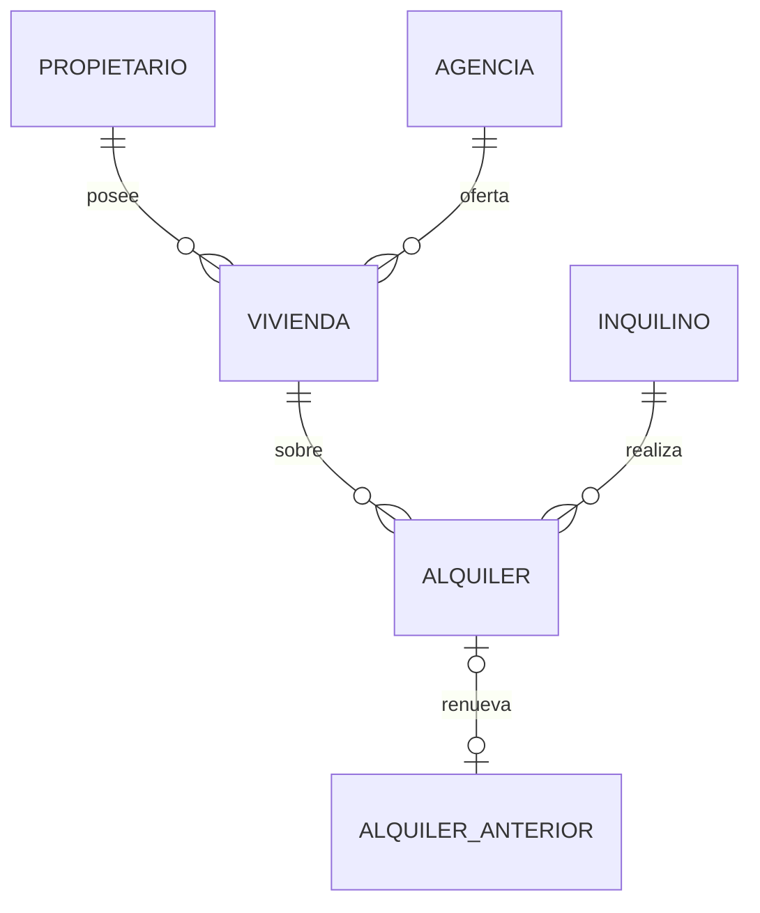
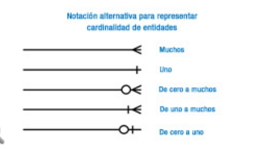
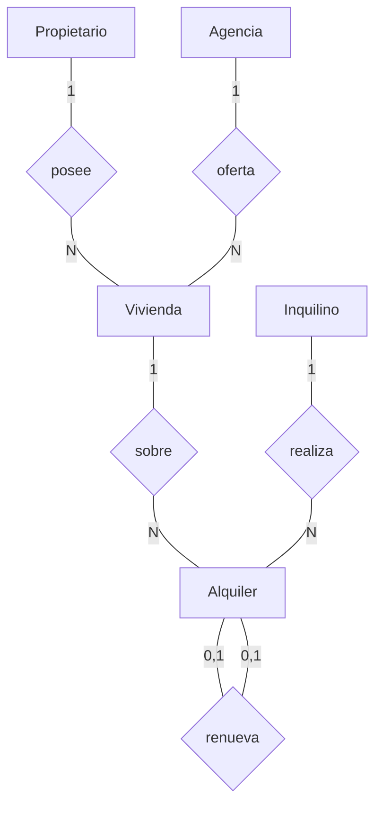

<!--
OBJETIVO: Solución E/R Sociedad Pública de Alquiler para proyectar en clase.
@author Agustin. A. Marquez. Pina
@see mailto:agu1406@outlook.es
@see https://github.com/Agu1406/ClasesParticulares
@see https://www.agustinmarquez.dev
@since 08/11/2026
-->

# E01 — E/R Alquileres (RESUELTO)

## Entidades y atributos

| Entidad | Atributos (PK subrayada conceptualmente) |
|----------|------------------------------------------|
| **Propietario** | *id_propietario*, nif (UQ), nombre, apellidos, telefono, direccion, email |
| **Vivienda** | *id_vivienda*, calle, numero, piso, codigo_postal, poblacion, descripcion |
| **Agencia** | *id_agencia*, cif (UQ), direccion, telefono |
| **Inquilino** | *id_inquilino*, nif (UQ), nombre, apellidos, fecha_nacimiento, telefono |
| **Alquiler** | *id_alquiler*, fecha_inicio, fecha_fin, importe_mensual, fianza, fecha_firma |

## Relaciones y cardinalidades

| Relación | Lectura | Card. |
|----------|---------|-------|
| posee | Un propietario tiene N viviendas; una vivienda 1 propietario | Propietario **1 — N** Vivienda |
| oferta | Una agencia oferta N viviendas; una vivienda 1 sola agencia | Agencia **1 — N** Vivienda |
| realiza | Un inquilino firma N alquileres; un alquiler 1 inquilino | Inquilino **1 — N** Alquiler |
| sobre | Una vivienda tiene N alquileres (histórico); un alquiler 1 vivienda | Vivienda **1 — N** Alquiler |
| renueva | Un alquiler puede renovar a lo sumo otro; uno puede ser renovado por 0..1 (o 0..N si permites cadenas) | Alquiler **(0,1) — (0,1)** Alquiler (auto-relación) |

### Renovación (decisión)

**Auto-relación** en Alquiler: atributo/FK `id_alquiler_anterior` (opcional).  
Así se encadena el histórico con la misma persona/vivienda sin inventar entidad extra.

Alternativa válida: atributo booleano `es_renovacion` + FK al alquiler previo (equivalente).

## Diagrama (ASCII)

```text
[Propietario] 1 ----posee---- N [Vivienda] N ----oferta---- 1 [Agencia]
                                   |
                                   | 1
                                   |
                                   N
                              [Alquiler] N ----realiza---- 1 [Inquilino]
                                   |
                            renueva (0,1)
                                   |
                              [Alquiler]
```

## Diagrama con pata de gallina (Crow's Foot)

En Mermaid, `erDiagram` dibuja las **patas de gallina** en los extremos de la línea. El texto tras `:` es el **nombre de la relación** (el verbo del rombo Chen).



`ALQUILER_ANTERIOR` es la misma entidad **Alquiler** (auto-relación); se dibuja aparte para que el preview no rompa.

### Leyenda (igual que en clase)



| Símbolo Mermaid (lado derecho) | Significado |
|--------------------------------|-------------|
| `||` | Exactamente **uno** (obligatorio) |
| `|{` | De **uno a muchos** |
| `o{` | De **cero a muchos** |
| `o|` | De **cero a uno** |
| `{` / pata | **Muchos** |

En este diagrama:

| Relación | Lectura Crow's Foot |
|----------|---------------------|
| `posee` | 1 propietario — 0..N viviendas (`\|\|--o{`) |
| `oferta` | 1 agencia — 0..N viviendas |
| `sobre` | 1 vivienda — 0..N alquileres |
| `realiza` | 1 inquilino — 0..N alquileres |
| `renueva` | 0..1 — 0..1 (`\|o--o\|`) |

### Vista Chen (rombos) — misma semántica



## Notas de corrección en clase

- Si alguien pone Agencia N–M Vivienda: **incorrecto** (“una vivienda solo se oferta en una agencia”).
- El histórico NO obliga entidad “Historico”: basta Vivienda 1–N Alquiler + fechas.
- NIF de inquilino/propietario: además del id, conviene **UNIQUE**.
